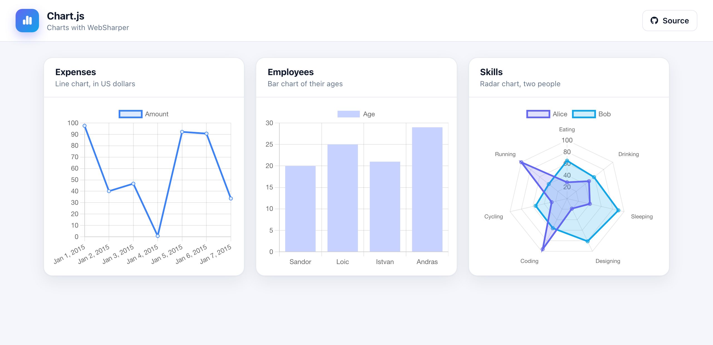

# WebSharper Chart.js

A small dashboard of [Chart.js](https://www.chartjs.org/) charts built with the
[WebSharper.ChartJs](https://github.com/dotnet-websharper/chartjs) bindings: a
line chart, a bar chart and a radar chart.



## How it works

- `src/Client.fs` builds the three `ChartData` sets and renders each one onto a
  `<canvas>` in an `on.afterRender` handler. Charts are responsive, filling
  their card rather than a fixed canvas size.
- `src/wwwroot/index.html` is the whole page — the header and the three chart
  cards — bound with `.Bind()`.

Chart.js is loaded as a native ES module: `index.html` carries an **import map**
for the `chart.js/auto` specifier that the binding emits.

## Running locally

```
dotnet run --project src
```

Then open <http://localhost:5398>.

## Building

```
dotnet build src/ChartJS.fsproj -c Release
```

WebSharper compiles the client and [esbuild](https://esbuild.github.io/) bundles
it into `src/wwwroot/Scripts`.

## Deployment

Every push to `master` builds in Release and publishes `src/wwwroot` to the
`gh-pages` branch via `.github/workflows/deploy.yml`.
